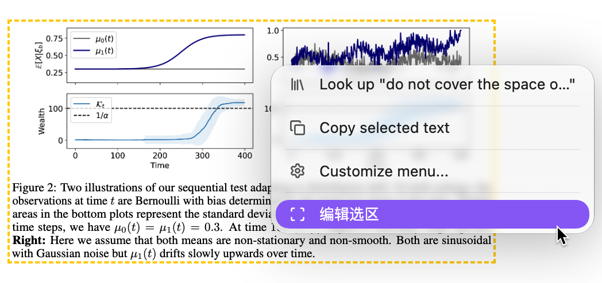
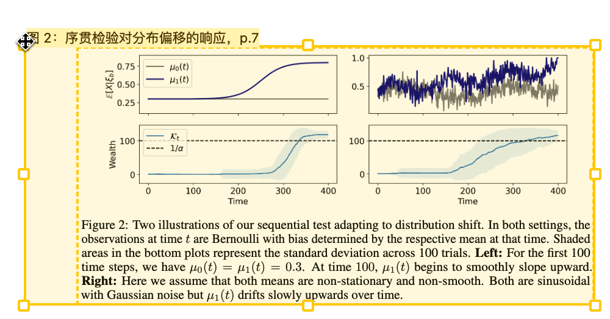
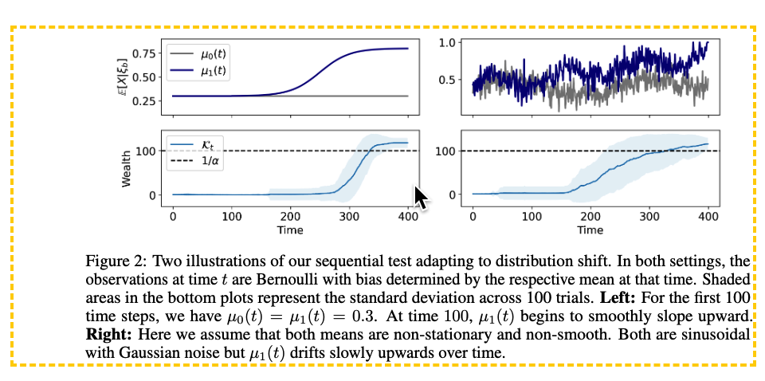

# PDF++ Region Editor

用鼠标移动、缩放已有的 PDF++ 矩形选区，同步更新 Markdown 链接和 Excalidraw 图片裁切。

[English](README.md) · [简体中文](README.zh-CN.md)

这是为 [PDF++](https://github.com/RyotaUshio/obsidian-pdf-plus) 开发的独立配套插件，由 [Tang-Jay](https://github.com/Tang-Jay) 维护，并非 PDF++ 官方版本。

## 三步调整已有选区

**直接调整已添加到笔记中的选区，无需重新框选、再次插入笔记。** 松开鼠标后自动保存，并更新原笔记中的选区引用。

### 1. 右键进入编辑

在已有选区内或边缘附近单击右键，选择菜单中的 **“编辑选区”**。



### 2. 拖动调整范围

拖动选框四角或边缘的手柄，调整选区范围；拖动框内区域可以移动整个选区。



### 3. 松开自动保存

松开鼠标后，新范围自动保存并返回展示状态，原笔记中的选区引用同步更新。无需二次画出选区，也无需重新添加到笔记，可以直接继续阅读。



## 功能

- 移动选区，或使用八个手柄调整选区大小。
- 在支持旋转 PDF 预览的对话框中编辑选区。
- 在 PDF 阅读器中右键选区直接编辑，松开鼠标后保存。
- 更新选中的 Markdown 链接，保留颜色、别名、嵌入标记和其他参数。
- 同步更新 Excalidraw PDF 图片的裁切、链接、显示尺寸和独立画框。
- 取消调整，或撤销上一次受支持的编辑。
- 如果来源笔记、图片或画框已经变化，拒绝保存过期的编辑结果。

插件只修改链接和绘图数据，不修改 PDF 原文件。

## 使用要求与兼容性

- 支持桌面版 Obsidian，暂未声明支持移动端。
- PDF 阅读器右键编辑和 PDF++ 选区渲染需要启用 PDF++。
- 画布集成需要启用 [Excalidraw](https://github.com/zsviczian/obsidian-excalidraw-plugin)。
- PDF 链接必须指向本库内的实际 PDF 文件。编辑对话框的文件加载器不支持远程 PDF 或 PDF++ 虚拟 PDF（dummy PDF）。
- 当前插件界面使用中文。

`0.4.3` 已在 macOS `15.7.9`、Obsidian `1.15.0`、PDF++ `0.40.31` 和 Excalidraw `2.29.1` 环境中测试。最低 Obsidian 版本保守设为实际验证过的 `1.15.0`。尚未测试 Windows、Linux、移动端或更早的 Obsidian 版本。Excalidraw 另有自己的 Obsidian 版本要求。

PDF 阅读器集成使用了 Obsidian 内部接口、PDF++ 设置和右键菜单钩子；画布集成使用了 Excalidraw 接口。这些应用更新后，可能需要相应更新本插件。

## 安装

请先安装并启用 PDF++；如需画布功能，再启用 Excalidraw。

### 社区目录安装

打开[社区插件页面](https://community.obsidian.md/plugins/pdf-rect-editor)，点击 **Add to Obsidian**；也可以在 **设置 → 第三方插件 → 浏览** 中搜索 **PDF++ Region Editor**。如果客户端暂时还找不到条目，可以使用下面的手动安装方式。

### 手动安装

1. 在 Obsidian 中安装并启用 PDF++；如需画布功能，再启用 Excalidraw。
2. 从 [GitHub Releases](https://github.com/Tang-Jay/obsidain-pdf-rect-editor/releases) 下载 `main.js`、`manifest.json` 和 `styles.css`。
3. 创建 `<vault>/.obsidian/plugins/pdf-rect-editor/` 文件夹，将三个文件直接放入其中。
4. 重启 Obsidian，在 **设置 → 第三方插件** 中启用 **PDF++ Region Editor**。

也可以按照下方开发说明从源码构建，再复制相同的三个文件。

## 使用方法

### 编辑 Markdown 选区链接

1. 在 Markdown 笔记的源码模式或实时预览编辑器中，将光标放入一个已有的选区链接，例如：

   ```text
   ![[paper.pdf#page=1&rect=100,200,300,400&color=yellow|Figure 1]]
   ```

2. 运行 **PDF++ Region Editor: 编辑光标所在的 PDF 选区**，点击侧边栏的 **调整 PDF 选区** 图标，或使用编辑器右键菜单中的对应操作。
3. 拖动选区内部可移动选区，拖动手柄可调整大小。点击 **旋转 90°** 可旋转预览。
4. 点击 **保存选区** 更新链接；按 **Esc** 或点击 **取消** 放弃编辑。保存后可以使用笔记编辑器的常规撤销操作恢复。

### 在 PDF 阅读器内编辑

1. 打开一个 PDF，其已有 `rect` 选区链接位于笔记或受支持的绘图中。
2. 右键对应选区，选择 **编辑选区**。
3. 拖动选区或手柄，松开鼠标后保存并退出编辑。拖动时按 **Esc** 可取消。
4. 如果选区对应多个来源，通过右键菜单中的 **选区来源笔记** 选择要更新的笔记或绘图。
5. 使用 **撤销上次选区调整** 撤销当前阅读器控制器上一次保存。此撤销仅在当前阅读器会话中有效；如果来源已变化，将拒绝撤销。

页面内直接编辑默认开启，可在插件设置中关闭 **PDF 页面内直接编辑**。

### 编辑 Excalidraw PDF 裁切图片

1. 选中一张 PDF 裁切图片，或只包含该图片的画框。
2. 运行 **PDF++ Region Editor: 编辑选中的 Excalidraw PDF 选区**，或点击侧边栏图标。
3. 调整选区并保存，图片裁切、PDF 链接、显示尺寸和画框尺寸会同步更新。
4. 如需撤销对话框中的编辑，运行 **PDF++ Region Editor: 撤销上次画布选区调整**。撤销记录保存在内存中，重新加载插件后不会保留。

图片必须具有原生 PDF 裁切元数据和有效的 PDF `rect` 链接。不支持旋转后的绘图元素，也不支持与其他元素共用的画框。如果多张图片使用同一选区，请先在来源绘图中选中要修改的图片，再从 PDF 阅读器进入编辑。

## 链接支持与限制

- 支持包含正整数 `page` 参数、且仅含一个有效 `rect=x1,y1,x2,y2` 参数的双链和嵌入链接。
- 拒绝编辑包含 `annotation` 参数的链接，避免只改变矩形坐标而导致标注不一致。
- 只编辑已有选区，不负责创建初始选区链接。
- 更新指定的链接或图片，不会批量替换整个库中的所有匹配链接。
- 保存的坐标四舍五入到小数点后两位；原有颜色参数保持不变。
- 验证包括 18 项单元测试和 28 项通过 Obsidian CLI 驱动的应用内检查。测试范围和限制见[兼容性测试记录](docs/compatibility.md)。

## 隐私与文件访问

本插件自身代码不发起网络请求，不收集遥测数据，也不访问库外文件。它读取库内 PDF 和笔记，更新指定的笔记链接或绘图数据，并将页面内编辑偏好保存在插件的 `data.json` 中。PDF++、Excalidraw 和 Obsidian 各自有独立的行为与设置。

## 开发

使用带内置测试运行器的较新 Node.js 版本，例如 Node.js 22 或更新版本。当前构建和测试不需要安装 npm 依赖；`obsidian` 由宿主应用在运行时提供。

```sh
npm test
npm run build
node --check main.js
```

修改 `src/` 中的源码；`main.js` 由 `build.cjs` 生成。发布附件为 `main.js`、`manifest.json` 和 `styles.css`。

发布时保持 `manifest.json` 与 `package.json` 版本一致；最低 Obsidian 版本变化时更新 `versions.json`。GitHub Release 标签必须与 manifest 版本完全一致，例如 `0.4.3`，不加 `v` 前缀。三个发布附件需分别上传。

## 许可证

采用 MIT 许可证。Copyright (c) 2026 Tang-Jay。详见 [LICENSE](LICENSE)。

PDF++ 和 Excalidraw 是独立安装的插件，本仓库不包含它们的源码或二进制文件；各自的许可证继续适用于对应项目。

## 致谢

- Ryota Ushio 开发的 [PDF++](https://github.com/RyotaUshio/obsidian-pdf-plus) 提供了本插件扩展的选区链接工作流。
- [Excalidraw for Obsidian](https://github.com/zsviczian/obsidian-excalidraw-plugin) 提供了绘图与 PDF 裁切集成。
- [Obsidian](https://obsidian.md) 提供了插件运行环境和 PDF 阅读器。
